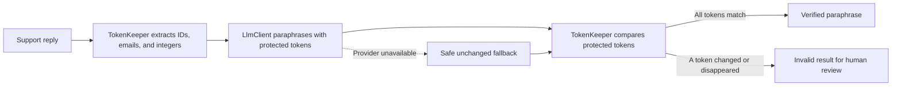

# Paraphrase Desk

Paraphrase Desk is a small support-writing workspace for Harbor Desk replies. It improves clarity and tone while extracting and checking order IDs, email addresses, and integers so important customer details remain intact. The app is a public, guest-accessible demo built with Laravel 13, Inertia, and Vue 3.

## How the AI flow works



The language model sits behind `App\Services\Llm\LlmClient`. Gemini is optional; `GEMINI_API_KEY` enables the Gemini client, which has a 12-second HTTP timeout. Without a key, the app uses a deterministic local demo client. If a provider fails, the original reply is returned unchanged and checked. A generated reply that drops or changes a protected token is stored and explicitly marked invalid rather than silently accepted.

## Run locally

Requirements: PHP 8.3+, Composer, Node.js 22+, and npm.

```sh
composer install
cp .env.example .env
php artisan key:generate
php artisan migrate --seed
npm install
npm run dev
```

In a second terminal, run `php artisan serve` and open <http://127.0.0.1:8000>. The seeded database includes three fictional Harbor Desk replies with order IDs; choose one of the sample chips to try the workflow. No account or API key is needed. Add `GEMINI_API_KEY=...` to `.env` to opt into Gemini. The default database is SQLite.

## Tests and checks

```sh
php artisan test
composer lint:check
vendor/bin/phpstan analyse --memory-limit=512M
npm run check
npm run types:check
npm run build
```

Pest verifies extraction of IDs, emails, and integers; confirms `HD-2044` survives a rewrite; checks that the fake `LlmClient` is used for guest requests without a key; asserts the guest POST endpoint returns HTTP 200; and proves that a provider response that drops a protected token is flagged invalid. Tests use SQLite in memory and never call Gemini.

## Architecture

- `App\Services\Text\TokenKeeper` deterministically extracts protected values and compares the extracted token multisets after rewriting.
- `App\Services\Text\ParaphraseService` coordinates token extraction, the LLM interface, validation, and the safe provider-failure fallback.
- `App\Services\Llm\FakeLlmClient` provides a no-key local experience; `GeminiLlmClient` is selected only when `GEMINI_API_KEY` is set.
- `ParaphraseJob` stores the source and job status. `Paraphrase` stores the rewritten text, extracted token list, and validity result.
- `resources/js/pages/Welcome.vue` is the guest workspace; `POST /paraphrases` returns the rewrite and token audit as JSON.

All seeded reply details are fictional. Paraphrase jobs are stored locally in the configured database for the demo; when Gemini is enabled, submitted text is sent to Google's Gemini API for rewriting.
